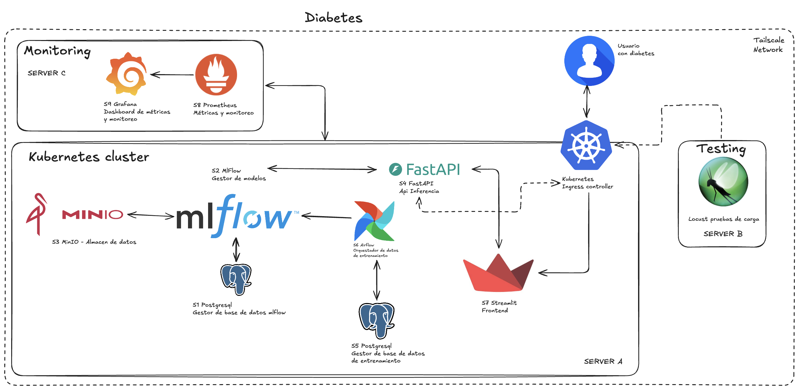

# diabetes-mlops

Plataforma MLOps de extremo a extremo para predecir el riesgo de diabetes. Cubre el ciclo completo: orquestación del entrenamiento, registro y versionado de modelos, servicio de inferencia, interfaz para el usuario final, monitoreo y pruebas de carga.

## Arquitectura



La plataforma se despliega sobre tres servidores conectados por una red Tailscale:

| Servidor | Rol | Componentes |
|----------|-----|-------------|
| Server A | Clúster Kubernetes | S1 PostgreSQL (metadatos de MLflow), S2 MLflow (gestor de modelos), S3 MinIO (almacén de artefactos), S4 FastAPI (API de inferencia), S5 PostgreSQL (datos de entrenamiento), S6 Airflow (orquestador de entrenamiento), S7 Streamlit (frontend), Ingress controller |
| Server B | Pruebas de carga | Locust |
| Server C | Monitoreo | S8 Prometheus (métricas), S9 Grafana (dashboards) |

Flujo principal: Airflow toma los datos de entrenamiento desde PostgreSQL, entrena y registra el modelo en MLflow, que persiste los artefactos en MinIO. La API de inferencia carga el modelo desde MLflow y expone las predicciones al frontend de Streamlit a través del Ingress. Prometheus recolecta las métricas del clúster y Grafana las visualiza.

## Estructura del repositorio

```
apps/            servicios propios: api-inference (FastAPI), frontend (Streamlit), airflow (DAGs)
ml/              paquete python compartido con la lógica del modelo
notebooks/       análisis exploratorio que justifica el procesamiento
infra/database/  migraciones SQL de las capas RAW, CLEAN e INFERENCE
infra/k8s/       manifiestos kustomize por servicio
infra/monitoring observabilidad con Prometheus y Grafana (Server C)
infra/load-testing  pruebas de carga con Locust (Server B)
```

## Dataset

Descarga el dataset Diabetes 130-US hospitals indicado en el taller desde la raíz
del repositorio:

```bash
python3 -m pip install -r scripts/requirements.txt
python3 scripts/download_diabetes_dataset.py
```

El archivo se guarda en `data/Diabetes/Diabetes.csv`. El script valida que sea
un CSV legible con las columnas `encounter_id` y `readmitted`, cuenta los
registros y no vuelve a descargar un archivo válido que ya exista. Para
reemplazarlo, ejecuta `python3 scripts/download_diabetes_dataset.py --force`.
El dataset descargado está excluido de Git.

El diseño de las tablas RAW, CLEAN e INFERENCE, las reglas de trazabilidad y
el contrato de entrada/salida de inferencia están documentados en
[docs/data-contract.md](docs/data-contract.md). La migración PostgreSQL inicial
está en
[infra/database/migrations/001_create_data_contract.sql](infra/database/migrations/001_create_data_contract.sql).

## Análisis y procesamiento

[notebooks/01_eda.ipynb](notebooks/01_eda.ipynb) contiene el análisis
exploratorio que justifica la limpieza, la ingeniería de características
(`readmission-features-v2`), la partición por paciente y la métrica de
selección. Para ejecutarlo localmente:

```bash
python3 -m venv .venv
.venv/bin/pip install -e ./ml/diabetes_model jupyter matplotlib
.venv/bin/jupyter lab notebooks/01_eda.ipynb
```

El paquete compartido `ml/diabetes_model` implementa esas reglas una sola vez y
lo reutilizan el DAG y la API:

- `contract.py`: esquema de la fuente, validación por registro, exclusión de
  fallecidos/hospicio y el contrato de 44 campos de entrada.
- `features.py`: 37 variables del modelo (diagnósticos ICD-9 agrupados,
  especialidad, edad ordinal, conteos de visitas y medicamentos, …).
- `splits.py`: partición 70/15/15 por hash de paciente, estable entre lotes.
- `models.py`: candidatos (regresión logística, gradient boosting, random
  forest), métricas y el pipeline que se sirve.

Para entrenar los candidatos sobre el CSV completo y ejecutar las pruebas:

```bash
.venv/bin/pip install -e ./ml/diabetes_model pytest
.venv/bin/python -m diabetes_model data/Diabetes/Diabetes.csv
.venv/bin/python -m pytest ml/diabetes_model/tests
```

La métrica principal es el **macro-F1 de validación**: las clases están
desbalanceadas (`<30` es el 11%) y el macro-F1 pondera por igual las tres. Con
el dataset completo el mejor candidato es gradient boosting (macro-F1 de
validación 0,441, test 0,441), frente a 0,425 de la regresión logística v1.

## DAG de entrenamiento

El DAG `diabetes_incremental_training` simula la llegada incremental de datos:
**cada ejecución carga un lote nuevo** (máximo 15.000 filas) y reentrena con
todo lo acumulado. Tareas:

1. `validate_source_file`: descarga el CSV si falta y valida esquema y forma.
2. `ingest_next_batch`: carga a `raw.records` el siguiente lote pendiente.
3. `validate_raw_quality`: marca cada fila `validated`/`rejected` con su motivo;
   falla si un lote supera 1% de rechazos.
4. `preprocess_raw_to_clean`: lee RAW (no el CSV), aplica la transformación y
   deja el resultado en `clean.records_staging`.
5. `store_clean_records`: fusiona staging en `clean.records` de forma atómica.
6. `split_dataset`: asigna train/validation/test por paciente y verifica que
   no haya fuga entre particiones.
7. `check_training_needed`: omite el entrenamiento si no hay datos nuevos.
8. `train_candidates`: entrena los 3 candidatos como runs anidados de MLflow
   (parámetros, métricas, matrices de confusión, reportes y modelo).
9. `register_best_model`: registra el mejor por macro-F1 de validación.
10. `compare_with_champion`: evalúa la nueva versión y la versión productiva
    sobre la misma validación, cargándolas desde el registro.
11. `promote_model`: mueve el alias `production` solo si la nueva versión es
    mejor.

Por defecto se ejecuta cada 10 minutos (`DIABETES_TRAINING_SCHEDULE`), sin
catchup y con una sola ejecución activa; las tareas se reintentan dos veces.
Es reejecutable: los lotes tienen IDs deterministas, RAW es único por
checksum y fila, CLEAN por registro y versión de transformación, y cada
versión registrada lleva la huella del snapshot de CLEAN con el que se
entrenó. Una vez cargados los 7 lotes, las ejecuciones siguientes no
entrenan.

Compose aplica las migraciones de `infra/database/migrations` con el servicio
`train-db-migrate` antes de iniciar Airflow. La conexión a PostgreSQL se
configura con `TRAIN_DB_*` o `TRAIN_DATABASE_URL`, y MLflow con
`MLFLOW_TRACKING_URI`. En Kubernetes, monta un volumen persistente escribible
en `DIABETES_DATASET_PATH` y permite salida HTTPS a Google Drive. El detalle de
tablas, reglas y contrato de inferencia está en
[docs/data-contract.md](docs/data-contract.md).

Si ya habías ejecutado la versión anterior del DAG, los datos en
`postgres-train` y el modelo `diabetes` corresponden a la carga completa v1.
Para repetir la carga incremental desde cero, elimina los volúmenes de datos:
`docker compose down && docker volume rm diabetes_postgres_train diabetes_mlflow_db diabetes_minio`.
