# Diabetes MLOps · Kubernetes, Airflow y MLflow

**Grupo 6:** Kevin Bueno · Juan Camilo Martínez · Jorge Andrés Gil

Plataforma MLOps de extremo a extremo para predecir el riesgo de readmisión hospitalaria en pacientes con diabetes (dataset Diabetes 130-US hospitals, clases `NO`, `>30` y `<30`). Airflow carga los datos por lotes en PostgreSQL, entrena tres candidatos y registra el mejor en MLflow con el alias `production`; los artefactos viven en MinIO, una API FastAPI sirve `models:/diabetes@production` en `POST /predict` y un frontend Streamlit lo consulta. Todo Server A corre en Kubernetes (OrbStack) con autoescalado de la API; Locust (Server B) genera carga y Prometheus + Grafana (Server C) la observan.

## Ruta rápida

1. Instalar en el clúster, una sola vez, el Ingress controller y metrics-server (OrbStack no trae ninguno; el HPA necesita el segundo):

   ```bash
   kubectl apply -f https://raw.githubusercontent.com/kubernetes/ingress-nginx/controller-v1.15.1/deploy/static/provider/cloud/deploy.yaml
   kubectl apply -f https://github.com/kubernetes-sigs/metrics-server/releases/download/v0.9.1/components.yaml
   ```

2. Desplegar Server A completo (usa las imágenes publicadas en Docker Hub, no hace falta construir nada):

   ```bash
   kubectl apply -k infra/k8s
   kubectl -n diabetes get pods        # esperar Running / Completed; el primer arranque tarda unos minutos
   ```

3. Activar el DAG `diabetes_incremental_training` en <http://airflow.k8s.orb.local> (`airflow` / `airflow`). Se crea pausado; al activarlo el scheduler lanza la primera corrida, que carga el primer lote, entrena y deja el modelo `diabetes` con el alias `production` en MLflow (alrededor de un minuto):

   ```bash
   kubectl -n diabetes exec deploy/airflow -c scheduler -- airflow dags unpause diabetes_incremental_training
   ```

4. Revisar los runs en <http://mlflow.k8s.orb.local> y la versión servida en <http://api.k8s.orb.local/model-info> (`"status": "ready"`; la API recarga el alias sola cada 60 s).
5. Predecir desde el frontend <http://frontend.k8s.orb.local> (botón **Cargar ejemplo** y **Predecir**) o por API. El cuerpo lleva los 44 campos del contrato de [docs/data-contract.md](docs/data-contract.md):

   ```bash
   curl -s -X POST http://api.k8s.orb.local/predict -H 'Content-Type: application/json' -d @payload.json
   ```

   Respuesta esperada:

   ```json
   {
     "request_id": "8a5dbc13-bb70-4301-bb2e-b6ed8021fa0b",
     "prediction": "<30",
     "probabilities": { "NO": 0.35, ">30": 0.23, "<30": 0.41 },
     "model": { "name": "diabetes", "version": "2", "alias": "production" },
     "processing_time_ms": 36.8
   }
   ```

   La documentación interactiva está en <http://api.k8s.orb.local/docs>.

> Mientras no exista un modelo con el alias `production`, `/predict` responde `503` y `/health` responde `200` con `model_loaded=false`. No hace falta reiniciar la API: consulta el registro cada `MODEL_REFRESH_SECONDS` y `POST /model/reload` fuerza la carga.

## Arquitectura

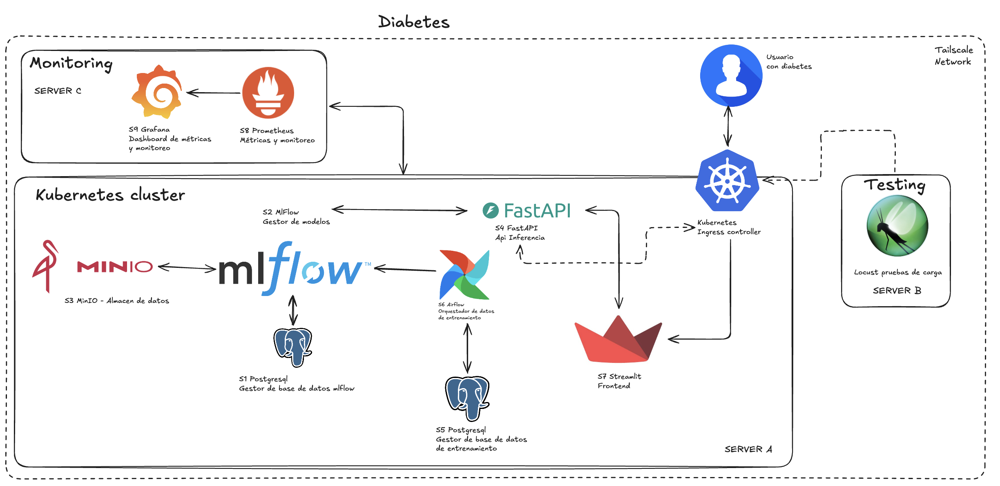

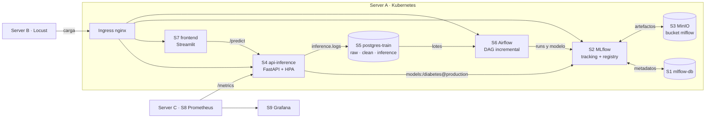

Los tres servidores se conectan por una red Tailscale. En OrbStack todo Server A queda en el namespace `diabetes` y el Ingress resuelve los hosts `*.k8s.orb.local` desde el Mac.

| Servicio | URL | Credenciales | Rol |
|----------|-----|--------------|-----|
| `mlflow-db` (S1) | solo red interna | `mlflow` / `mlflow` | Backend store de MLflow |
| `mlflow` (S2) | <http://mlflow.k8s.orb.local> | sin autenticación | Tracking server y Model Registry; sirve los artefactos por proxy hacia MinIO |
| `minio` (S3) | consola `http://minio.diabetes.svc.cluster.local:9001` | `minioadmin` / `minioadmin` | Almacén de artefactos, bucket `mlflow` (lo crea el Job `minio-init`) |
| `api-inference` (S4) | <http://api.k8s.orb.local> | sin autenticación | Sirve `models:/diabetes@production`; HPA de 1 a 20 pods al 70 % de CPU |
| `postgres-train` (S5) | solo red interna | `app` / `app`, base `diabetes` | Esquemas `raw`, `clean` e `inference` (migraciones por el Job `train-db-migrate`) |
| `airflow` (S6) | <http://airflow.k8s.orb.local> | `airflow` / `airflow` | api-server, scheduler, dag-processor y triggerer en un pod; metadatos en `airflow-db` |
| `frontend` (S7) | <http://frontend.k8s.orb.local> | — | Formulario de 44 campos; solo habla con la API |
| Prometheus (S8) · Grafana (S9) | <http://localhost:9090> · <http://localhost:3000> | Grafana `admin` / `admin` | `infra/monitoring`, perfil `monitoring` de compose (independiente en Server C) |
| Locust (Server B) | <http://localhost:8089> | — | `infra/load-testing`, perfil `loadtest` de compose |

## Infraestructura en Kubernetes

Todo Server A se despliega con `kubectl apply -k infra/k8s` en el namespace `diabetes`. Cada componente tiene su carpeta en `infra/k8s/base/<componente>` con el workload, su Service y, cuando aplica, PVC y Jobs; los ConfigMaps y Secrets se generan desde `.env` con `infra/k8s/scripts/render-env.sh`, que también fija la imagen `DOCKERHUB_USER/<imagen>:IMAGE_TAG` de los tres componentes propios.

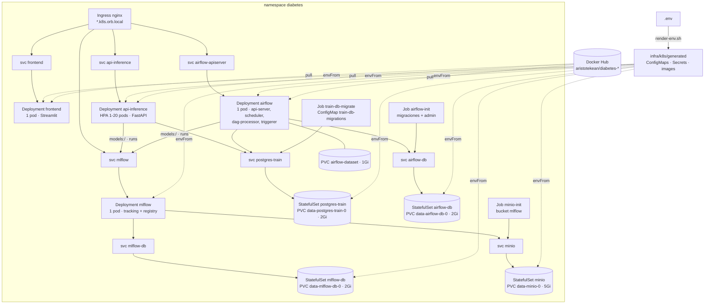

Las bases de datos y MinIO son `StatefulSet` con una réplica: el pod tiene identidad estable (`postgres-train-0`), su PVC sale de `volumeClaimTemplates` y sobrevive al pod, y una actualización termina el pod viejo antes de crear el nuevo, así nunca hay dos instancias escribiendo el mismo volumen. Cada uno tiene además un Service headless (`<nombre>-headless`) que exige el StatefulSet; los clientes siguen usando el Service normal. Los componentes sin estado son `Deployment`; la API escala con un HPA y su spool de logs de inferencia vive en un `emptyDir` para poder correr varias réplicas.

| Componente | Workload | ConfigMap | Secret | Persistencia | Probes | requests → limits |
|------------|----------|-----------|--------|--------------|--------|-------------------|
| `mlflow-db` | StatefulSet | `mlflow-db-env` | `mlflow-db-credentials` | `data-mlflow-db-0` (2Gi) | readiness, liveness (`pg_isready`) | 100m/256Mi → 500m/512Mi |
| `airflow-db` | StatefulSet | `airflow-db-env` | `airflow-db-credentials` | `data-airflow-db-0` (2Gi) | readiness, liveness (`pg_isready`) | 100m/256Mi → 500m/512Mi |
| `postgres-train` | StatefulSet + Job `train-db-migrate` | `postgres-train-env`, `train-db-migrations` | `postgres-train-credentials` | `data-postgres-train-0` (2Gi) | readiness, liveness (`pg_isready`) | 100m/256Mi → 500m/512Mi |
| `minio` | StatefulSet + Job `minio-init` | `minio-env` | `minio-credentials` | `data-minio-0` (5Gi) | readiness, liveness (`/minio/health/*`) | 100m/256Mi → 500m/1Gi |
| `mlflow` | Deployment | `mlflow-server-env`, `mlflow-client-env` | `mlflow-db-credentials`, `minio-credentials` | sin estado (Postgres + MinIO) | startup, readiness, liveness (`/health`) | 250m/512Mi → 1/2Gi |
| `api-inference` | Deployment + HPA | `api-inference-env`, `mlflow-client-env` | `postgres-train-credentials`, `minio-credentials` | `emptyDir` spool (256Mi) | startup, readiness, liveness (`/health`) | 250m/512Mi → 1/1Gi |
| `frontend` | Deployment | `frontend-env` | ninguno (no maneja credenciales) | sin estado | startup, readiness, liveness | 100m/256Mi → 500m/512Mi |
| `airflow` | Deployment + Job `airflow-init` | `airflow-env`, `mlflow-client-env` | `airflow-secrets`, `airflow-db-credentials`, `airflow-admin-user`, `minio-credentials`, `postgres-train-credentials` | `airflow-dataset` (1Gi) | api-server: startup, readiness, liveness; scheduler, dag-processor y triggerer: liveness | api-server 250m/512Mi → 500m/1Gi · scheduler 500m/1Gi → 1/2Gi · dag-processor 150m/256Mi → 250m/768Mi · triggerer 100m/256Mi → 250m/768Mi |

Los init containers de espera (`pg_isready`, `mc`) y los Jobs también declaran `requests` y `limits`; `bash infra/k8s/scripts/check.sh` renderiza `.env` y valida que el kustomize construya antes de commitear.

## Datos en PostgreSQL

`infra/database/migrations` crea tres esquemas en `postgres-train`. En Kubernetes los aplica el Job `train-db-migrate` (ConfigMap generado con `infra/k8s/scripts/render-migrations.sh`); en compose, el servicio del mismo nombre.

| Esquema | Contenido |
|---------|-----------|
| `raw` | Filas tal como llegan del CSV, por lote, con checksum y estado `validated` / `rejected` y su motivo |
| `clean` | Registros transformados por versión de transformación (`readmission-features-v2`), con partición `train` / `validation` / `test` por paciente |
| `inference` | `inference.logs`: una fila por petición a `/predict`, incluidas las fallidas, con entrada, salida, modelo y tiempo |

El dataset se descarga desde Google Drive al volumen persistente de Airflow en la primera corrida (`scripts/download_diabetes_dataset.py` hace lo mismo en local). El diseño de las tablas, las reglas de trazabilidad y el contrato de entrada y salida están en [docs/data-contract.md](docs/data-contract.md).

## Entrenamiento y registro del modelo

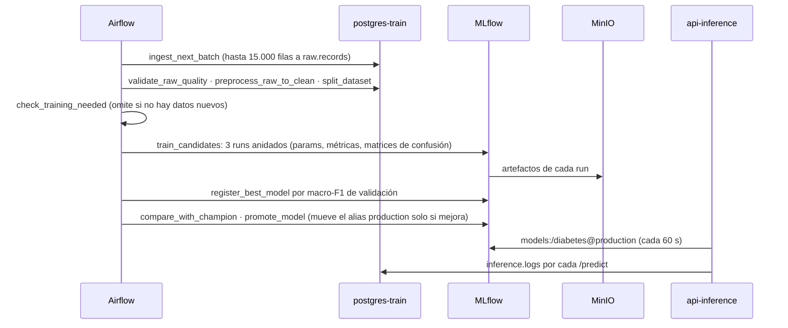

El DAG `diabetes_incremental_training` simula la llegada incremental de datos: cada corrida carga un lote nuevo y reentrena con todo lo acumulado. Corre cada 10 minutos (`DIABETES_TRAINING_SCHEDULE`), sin catchup, con una sola ejecución activa y dos reintentos por tarea. Es reejecutable: los lotes tienen IDs deterministas, RAW es único por checksum y fila, y cada versión registrada lleva la huella del snapshot de CLEAN con el que se entrenó. Cargados los 7 lotes, las corridas siguientes no entrenan.

El paquete compartido `ml/diabetes_model` implementa el contrato, las 37 variables, la partición y los candidatos una sola vez, y lo reutilizan el DAG y la API.

| Qué se registra | Detalle |
|-----------------|---------|
| Candidatos | Regresión logística, gradient boosting y random forest, como runs anidados del experimento `diabetes-readmission` |
| Métrica principal | Macro-F1 de validación: las clases están desbalanceadas (`<30` es el 11 %) y pondera las tres por igual |
| Selección | Con el dataset completo gana gradient boosting (macro-F1 0,441 en validación y test) frente a 0,425 de la regresión logística |
| Promoción | La versión nueva se evalúa contra la productiva sobre la misma validación; el alias `production` solo se mueve si mejora |

## Estructura del repositorio

```text
.
├── docker-compose.yml                # Stack completo en compose (incluye airflow, locust y monitoring)
├── apps/
│   ├── api-inference/                # S4 FastAPI: /predict, /health, /model-info, /model/reload, /metrics
│   ├── frontend/                     # S7 Streamlit
│   └── airflow/                      # S6 imagen y DAG diabetes_incremental_training
├── ml/diabetes_model/                # Paquete compartido: contrato, features, splits, modelos
├── infra/
│   ├── database/migrations/          # Esquemas raw, clean e inference
│   ├── k8s/                          # Manifiestos kustomize de Server A (S1–S7, Ingress, HPA)
│   ├── load-testing/                 # Server B: Locust
│   └── monitoring/                   # Server C: Prometheus y Grafana
├── notebooks/01_eda.ipynb            # Análisis exploratorio que justifica el procesamiento
├── scripts/publish_images.sh         # Publica las imágenes multi-arquitectura en Docker Hub
└── docs/                             # data-contract.md y capturas de evidencia
```

## Ejecutar las pruebas

Cada aplicación se prueba por separado con `uv`; ninguna necesita red, MLflow ni PostgreSQL.

```bash
cd apps/api-inference && uv sync && uv run pytest -q
cd apps/frontend && uv sync && uv run pytest -q
python3 -m venv .venv && .venv/bin/pip install -e ./ml/diabetes_model pytest && .venv/bin/python -m pytest ml/diabetes_model/tests
```

| Suite | Qué verifica |
|-------|--------------|
| `apps/api-inference/tests` | `/health` y `/model-info` con y sin modelo, una predicción por petición, `422` ante campos faltantes o tipos incorrectos, `503` sin modelo y las métricas Prometheus |
| `apps/frontend/tests` | El cliente HTTP de la API y la construcción de los 44 campos del formulario |
| `ml/diabetes_model/tests` | El contrato de entrada, la ingeniería de características y los candidatos |

## Operación

| Tarea | Cómo |
|-------|------|
| Levantar todo con compose en vez de Kubernetes | Copiar `.env.example` a `.env` y `docker compose up -d` (en Linux ajustar `AIRFLOW_UID` con `id -u`). MLflow en `localhost:5001`, API en `8000`, frontend en `8501`, Airflow en `8080` |
| Publicar una versión nueva | `IMAGE_TAG=0.1.2 scripts/publish_images.sh` construye `amd64` y `arm64` y publica. Siempre un tag nuevo: el nodo reutiliza un tag ya descargado aunque el contenido cambie |
| Redesplegar | Cambiar los tres `newTag` en `infra/k8s/kustomization.yaml`, `kubectl apply -k infra/k8s` y `kubectl -n diabetes rollout status deploy/api-inference deploy/frontend deploy/airflow`. Los PVC conservan modelo, bases y dataset |
| Cambiar una migración SQL | Editar `infra/database/migrations`, correr `bash infra/k8s/scripts/render-migrations.sh` y commitear el ConfigMap. `bash infra/k8s/scripts/check.sh` valida los manifiestos antes de commitear |
| Pausar el reentrenamiento | `kubectl -n diabetes exec deploy/airflow -c scheduler -- airflow dags pause diabetes_incremental_training` (en un portátil conviene tras la primera corrida) |
| Prueba de carga | `LOCUST_HOST=http://api.k8s.orb.local docker compose --profile loadtest up -d` y abrir `localhost:8089`; `LOCUST_STEP_LOAD=1` busca el punto de degradación por escalones |
| Observar el autoescalado | `kubectl -n diabetes get hpa api-inference -w` muestra CPU y réplicas en vivo; añade hasta 2 pods cada 30 s y quita 1 por minuto tras 2 minutos de calma |
| Monitoreo | `docker compose up -d prometheus grafana` levanta solo Prometheus y Grafana (`--profile monitoring up -d` los suma al stack completo); apuntar `prometheus/targets/api-targets.yml` a la API y `prometheus/targets/minio-targets.yml` a MinIO. Grafana abre en el dashboard **Diabetes · Inference API** (tráfico HTTP, latencias, errores, CPU/memoria del pod, MLOps y MinIO) |
| Actualizar un clúster desplegado con los `Deployment` anteriores de las bases y MinIO | Los `StatefulSet` crean PVC nuevos (`data-<nombre>-0`), así que los datos no migran solos. Tras `kubectl apply -k infra/k8s`, borrar los workloads viejos para que el Service no reparta tráfico entre ambos: `kubectl -n diabetes delete deployment mlflow-db airflow-db postgres-train minio`; los PVC viejos (`mlflow-db-data`, `airflow-db-data`, `postgres-train-data`, `minio-data`) quedan hasta borrarlos a mano. El DAG regenera datos y modelo en la primera corrida |
| Borrar todo | `kubectl delete -k infra/k8s` (los PVC y sus datos se van con el namespace) |

Locust y el monitoreo están detrás de los perfiles `loadtest` y `monitoring` del compose raíz, así que `docker compose up -d` no los arranca. Para el monitoreo:

```bash
docker compose up -d prometheus grafana        # solo Prometheus + Grafana (nombrar el servicio activa su perfil)
docker compose --profile monitoring up -d      # stack completo + monitoreo
```

Prometheus en <http://localhost:9090> y Grafana en <http://localhost:3000> (`admin` / `admin`). Si se levanta desde `infra/monitoring` o `infra/load-testing` por separado (Server C o Server B), el `--profile` también es obligatorio: sin él compose no arranca ningún servicio.

> Los Secrets llevan las credenciales de desarrollo de compose (`minioadmin`, `airflow`, `app`, `mlflow`). Son para un clúster local; cámbialas antes de exponerlo a otras máquinas.

## Solución de problemas

- `/predict` responde `503`: todavía no hay un modelo con el alias `production` o MLflow no es alcanzable. Activa el DAG y espera la primera corrida; `curl http://api.k8s.orb.local/model-info` muestra el último error.
- La API sigue sirviendo una versión vieja tras promover otra: el refresco es cada 60 s; `curl -X POST http://api.k8s.orb.local/model/reload` la fuerza.
- El HPA muestra `TARGETS <unknown>`: metrics-server no está instalado o aún no reporta (tarda alrededor de un minuto). Pods `Pending` al escalar: el nodo no tiene memoria libre que reservar (OrbStack: Settings → System).
- El pod corre una imagen distinta a la de Docker Hub: el tag ya existía en la máquina (`imagePullPolicy: IfNotPresent` y OrbStack comparte el almacén con Docker). Publica con un tag nuevo.
- `kubectl apply` dice que `airflow-init` es inmutable: el Job aún no venció su TTL de 10 minutos. `kubectl -n diabetes delete job airflow-init` y vuelve a aplicar.
- MLflow responde `403` o la UI carga sin runs desde otra máquina: añade el host a `MLFLOW_ALLOWED_HOSTS` y el origen a `MLFLOW_CORS_ALLOWED_ORIGINS` en `infra/k8s/base/mlflow/deployment.yaml`.
- Los hosts `*.k8s.orb.local` solo existen en OrbStack. En un servidor Linux sustitúyelos en `infra/k8s/base/ingress/ingress.yaml` por el nombre Tailscale del nodo y expón el controller con el LoadBalancer o NodePort del clúster.

## Evidencias

### 1. Imágenes publicadas en Docker Hub

Los tres repositorios públicos del namespace `aristotekean`: `diabetes-airflow`, `diabetes-frontend` y `diabetes-api-inference`, cada uno con el manifiesto multi-arquitectura (`linux/amd64` y `linux/arm64`) que consumen compose y Kubernetes.

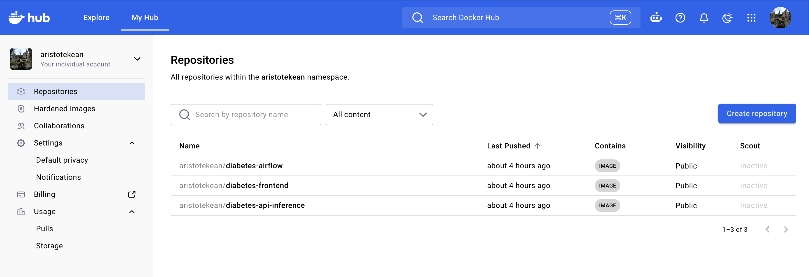

### 2. Clúster de Kubernetes

OrbStack con el namespace `diabetes` en ejecución: los pods de `airflow`, `airflow-db`, `api-inference`, `frontend`, `minio`, `mlflow`, `mlflow-db` y `postgres-train`, más `ingress-nginx-controller`. El detalle del pod de Airflow muestra los `initContainers` `wait-for-airflow-db` y `wait-for-migrations` y los cuatro contenedores (api-server, dag-processor, scheduler y triggerer). La salida de `kubectl get svc -A` y `kubectl get ingress -A` muestra los Services del namespace, el LoadBalancer del Ingress controller y el Ingress `diabetes` con los hosts `frontend`, `api`, `mlflow` y `airflow` en `k8s.orb.local`.

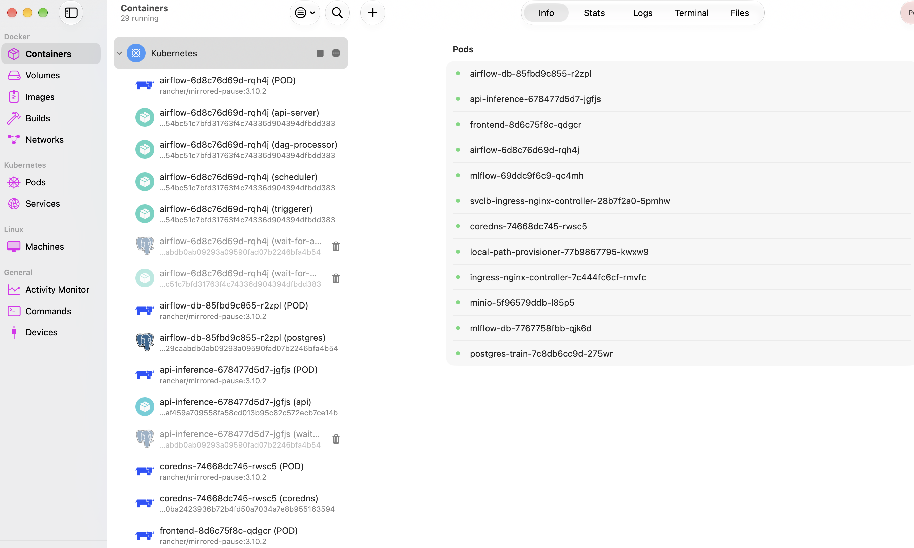

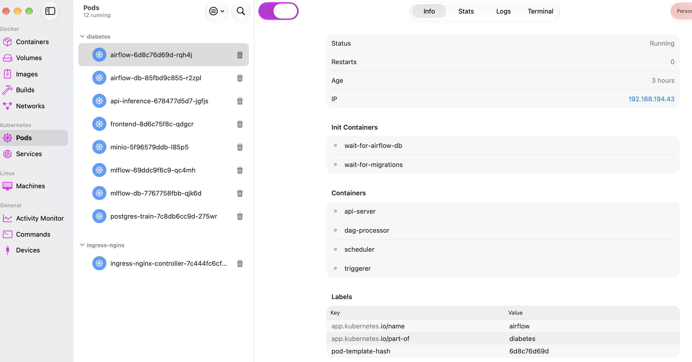

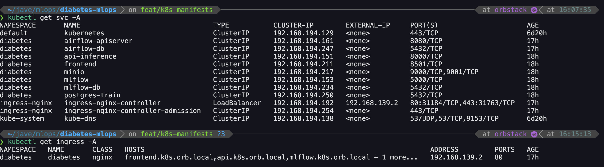

### 3. DAG de entrenamiento en Airflow

Corrida programada de `diabetes_incremental_training` con las once tareas en orden, de `validate_source_file` a `promote_model`. `train_candidates` tarda 31 s con el lote cargado; las demás, entre uno y tres segundos.

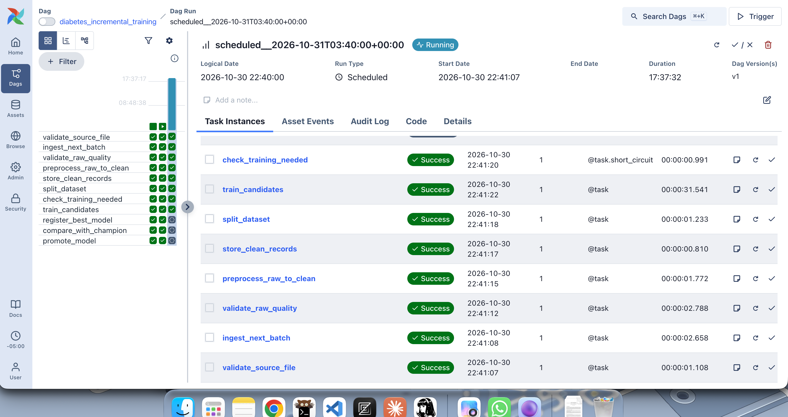

### 4. API de inferencia

Documentación interactiva de la Diabetes Inference API en `api.k8s.orb.local/docs`, con los endpoints `POST /predict`, `GET /health`, `GET /model-info` y `POST /model/reload`.

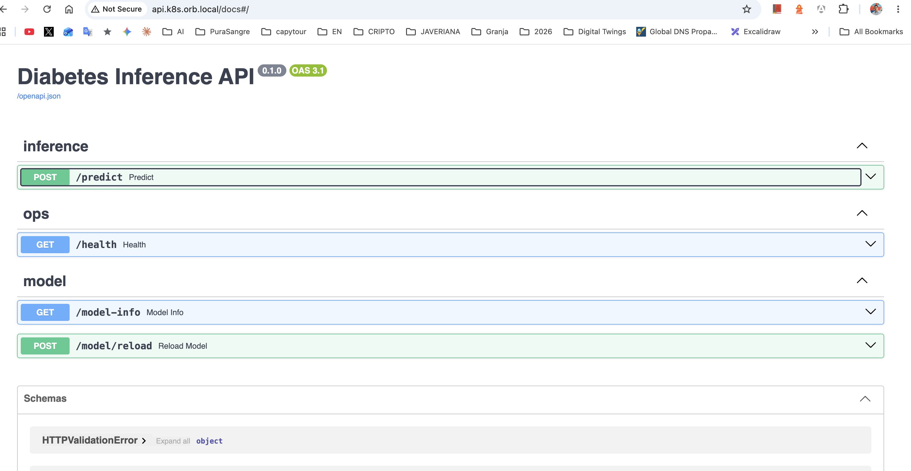

### 5. Frontend

Streamlit en `frontend.k8s.orb.local`: la barra lateral confirma la API disponible y el modelo productivo `diabetes` versión 2 con el alias `production`; el formulario carga un encuentro de ejemplo del dataset. Tras **Predecir**, la respuesta es `<30` (readmisión en menos de 30 días), con las probabilidades por clase, el modelo `diabetes v2`, 36,8 ms de procesamiento y el `request_id` registrado en `inference.logs`.

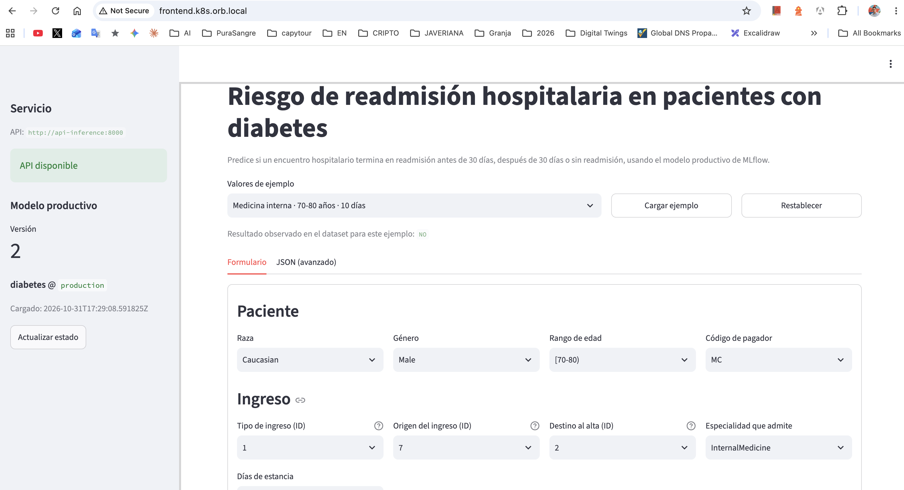

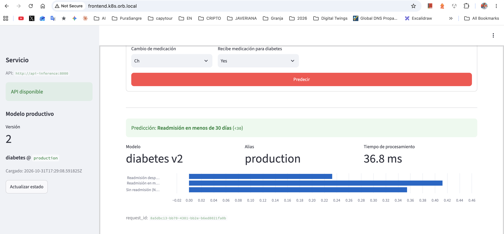

### 6. Experimentos en MLflow

MLflow 3.16.1 en `mlflow.k8s.orb.local`, experimento `diabetes-readmission` con los runs padre de cada corrida del DAG (`training-scheduled__…` y `training-manual__…`), con origen `airflow`; dentro de cada uno están los tres candidatos anidados.

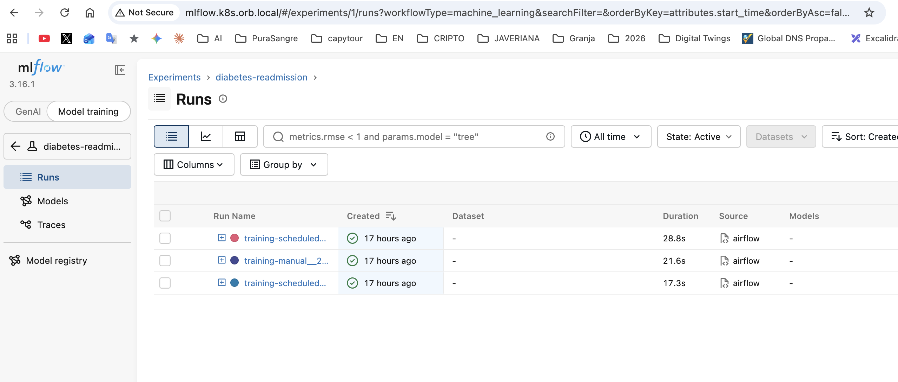
